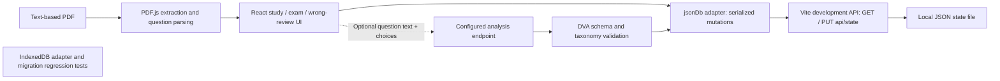

# PDF Question Bank

A React and TypeScript study application that extracts text-based PDF questions,
manages exam/review sessions, and optionally validates AI-generated DVA analysis.
The engineering focus is state recovery, storage boundaries and incremental external
analysis without overwriting source answers or explanations.

## Current architecture



**Storage boundary:** the current `src/App.tsx` imports `src/lib/jsonDb.ts`.
The Vite development middleware in `vite.config.ts` serves the local JSON state
API. `src/lib/db.ts` retains an IndexedDB implementation and migration tests, but
it is not the current main app storage adapter. Do not interpret its presence as
proof that the current app persists everything in IndexedDB.

The JSON adapter strips `sourcePdf` from saved question banks. Extracted question
records are not a backup of the original PDF Blob. Keep source PDFs separately.
The middleware is a local development facility, not a deployed production API;
a static build alone does not supply `/api/state`.

## Data and AI flow

- PDF parsing occurs locally; scanned-image PDFs require OCR, which is not provided.
- Exam sessions, results, wrong-answer history and bookmarks are distinct state.
  Review continuation and restart have different queue semantics.
- JSON mutations are serialized in the adapter; the development server writes a
  temporary file then renames it. This is not a multi-client database transaction.
- Optional analysis sends question text, choices, correct answers and original
  explanation to `VITE_DVA_ANALYSIS_ENDPOINT`. Therefore the optional feature does
  transmit question content; do not assume every workflow is entirely offline.
- Analysis is validated before persistence. Failed items remain retryable, while
  completed items need not be reprocessed. Original answers/explanations are preserved.

## Optional analysis contract

Configure `VITE_DVA_ANALYSIS_ENDPOINT` before starting the application. One request:

```json
{"question":"...","choices":[{"key":"A","text":"..."}],"correctAnswers":["D"],"originalExplanation":"..."}
```

The preferred response is `{"analysis": {...}}` matching `src/types.ts`; the
adapter also accepts the analysis object directly. Validation enforces known DVA
parts/patterns, difficulty 1–5 and structured distractor data. `OTHER` requires a
`suggestedPattern`. No inference backend or particular model is bundled.

Private local analysis bundles may be placed in
`public/local-data/dva-c02-analysis.json` (Git-ignored). Existing bundles merge by
`originalNumber`; availability and completeness depend on the supplied file.

```bash
npm run dva:extract -- /path/to/source.pdf
npm run dva:analyze-local
```

## Development and verification

```bash
npm ci
npm run dev:container
```

Use the isolated development origin `http://localhost:4173/pdf-question-bank/`.
Stop it with `npm run dev:container:down`. The existing port-5173 origin is reserved
for real study data and must not be used for automated verification.

```bash
npm run typecheck
npm test
npm run build
```

Tests cover parsing, study/review transitions, storage routing and IndexedDB
compatibility using fixtures. A build does not prove a working deployed state API
or external analysis endpoint. Never create test sessions in a real question bank.

## Supported text patterns

Question headers include `Question 1`, `Q1`, `Q. 1`, and `1.`; choices include
`A.`, `A)`, and `A:`. Answer markers include `Correct Answer`, `Correct Answers`
and `Answer`; explanations include `Explanation`, `Solution`, and `Rationale`.
PDF layout variations can require correction; parsing is not universally reliable.

## Engineering evidence and remaining work

Review `src/lib/pdf/`, `src/lib/dvaAnalysis.ts`, `src/lib/jsonDb.ts`, and the storage
and review regression tests. These demonstrate explicit state transitions, external
response validation and migration awareness. A production deployment needs a defined
storage backend and access control, plus measured analysis quality/cost; those are
future requirements, not claimed capabilities.
